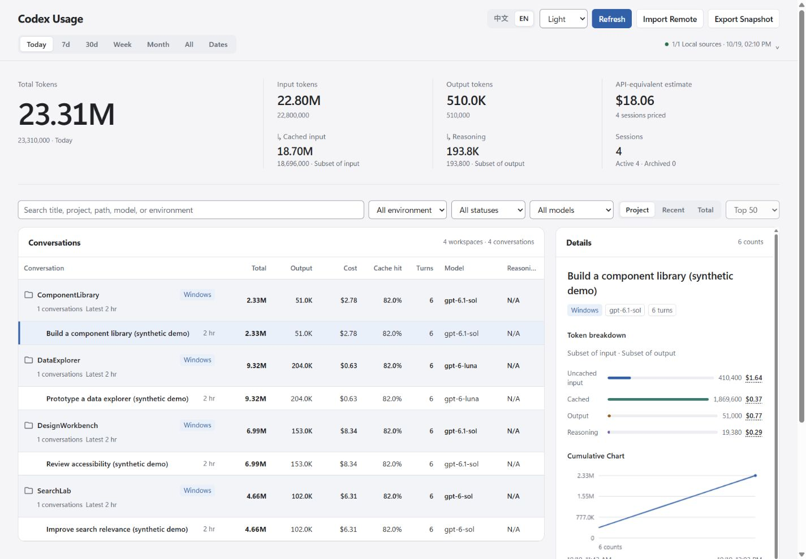

# Codex Usage Dashboard — Community Edition


Independent community fork of [luyh7/codex-usage-dashboard](https://github.com/luyh7/codex-usage-dashboard), licensed under MIT. This repository contains application code and synthetic tests only. It does not include personal sessions, source configurations, databases, authentication files or recovery archives.

## What This Fork Adds

- Persistent configuration for multiple local Codex homes, including backup/profile homes and source health/provenance.
- Explicit same-origin cross-source deduplication and continuation reconciliation. Different devices are not merged automatically.
- Lossless Windows filesystem identity storage in SQLite caches, with graceful fallback on cache failure.
- Event-level model attribution and token conservation, preserving cached-input and reasoning-output subset semantics.
- A refined light/dark dashboard with a focused usage overview, dense aligned tables, keyboard interaction, source disclosures and responsive layouts.
- An optional experimental read-only native-history projection exporter. It exports partial content only, never manufactures rollout events and never contributes native metadata counters to dashboard usage.

The screenshot below uses **synthetic demo sessions**. API-equivalent estimates are not subscription charges. Missing rollout data cannot be reconstructed into exact token accounting from native metadata alone.

See [configuration and accounting](docs/CONFIGURATION.md), [privacy](PRIVACY.md), [validation](docs/VALIDATION.md) and [upstream acknowledgements](#acknowledgements).

Codex-only skill for a local OpenAI Codex usage dashboard.

It reads your local Codex session logs and opens a browser dashboard for per-conversation usage: total tokens, output tokens, estimated dollar cost, cache hit rate, turns, model, reasoning effort, tool calls, and token-count timeline. It can also import JSON snapshots exported from other devices, so each machine can show local realtime usage plus manually imported remote usage.

> Currently only supports OpenAI Codex. It is not a Claude Code, Cursor, Continue, or generic OpenAI API dashboard.


## Why This Exists

Most usage tools show daily or project-level totals. This dashboard focuses on the thing Codex users often want to know:

**Which Codex conversation used the most?**

It shows a searchable conversation list and a detail view for each session, including the cost split for input, cached input, output, and reasoning tokens.

## Install With The Skills CLI

### Windows: double-click an EXE

Download **CodexUsageDashboard-Windows-x64.zip** from the [latest release](https://github.com/fishchipssss/codex-usage-dashboard/releases/latest), extract it, then double-click **CodexUsageDashboard.exe**. No Codex app, PowerShell, Python or Node.js is needed to launch it. You can create a desktop shortcut to the EXE.

See [Windows instructions, local data and build details](docs/WINDOWS.md).

### Codex skill

Recommended global Codex install:

```bash
npx skills add fishchipssss/codex-usage-dashboard -g -a codex -y
```

Then restart Codex or open a new Codex conversation. Type `/usage`, then select the **Codex Usage Dashboard** skill.

The skill opens the local dashboard in your browser.

## Install With npx

GitHub installer:

```bash
npx github:fishchipssss/codex-usage-dashboard
```

Install and create a desktop shortcut:

```bash
npx github:fishchipssss/codex-usage-dashboard -- --shortcut
```

Install and open immediately:

```bash
npx github:fishchipssss/codex-usage-dashboard -- --open
```

## Features

- Per-conversation Codex usage from local session logs.
- Default project view, grouped by environment and workspace, with switches for recent and total-token list views.
- Expandable main-agent task rows that show the combined usage of the main agent and its subagents, with nested subagent detail on demand.
- Compact list columns for total tokens, output tokens, cost, cache hit rate, turns, model, and reasoning effort.
- Detail view with token breakdown, estimated dollar cost, and hoverable unit prices for input, cached input, output, and reasoning.
- Effective-dated pricing with per-request GPT-5.6 short/long context tiers, so earlier usage is not repriced when a new model launches.
- GPT-6 Astra, Sol, Luna and GPT-6.1 Sol pricing, including the 272K input-token context boundary and Fast mode. Sol/Luna rates start September 22, 2026; GPT-6.1 Sol rates start September 29, 2026. Official launch dates have no published time, so the dashboard uses UTC midnight. GPT-6 Sol and GPT-6.1 Sol keep distinct cached-input rates ($0.20 and $0.10 per 1M tokens in short context). Sources: [pricing](https://developers.openai.com/api/docs/pricing), [changelog](https://developers.openai.com/api/docs/changelog).
- Fast mode detection from each session's recorded service tier, using published model-specific Fast rates (2x for the GPT-5.6 family).
- Fork-aware subagent accounting: inherited parent history is removed from child totals, costs, and timelines instead of being counted again.
- Token-count timeline with latest entries shown first.
- Tool call counts, project path, log file path, and session metadata.
- Local and read-only: reads Codex session logs from one or more local Codex homes; does not modify Codex logs.
- Reuses unchanged remote snapshots and cached session directory listings. Active logs are checked on every refresh; historical file metadata on Windows drives mounted under WSL is reused for up to two seconds between refreshes. Date filters also check the last event time inside logs whose file modification time is stale. New files, replacements, and archive moves invalidate their directory cache on the next refresh.
- Manual multi-device snapshots: export `cousash-<device-short-code>.json` from one device and import it into another dashboard as remote data.
- WSL + Windows support: when running in WSL, automatically merges WSL `~/.codex` with Windows `/mnt/c/Users/<you>/.codex` when present.
- Cross-platform: works on Windows and macOS with Python 3.
- No API key required.

## What Gets Installed

The standard skills CLI installs:

```text
~/.codex/skills/codex-usage-dashboard
```

The bundled npm installer copies the same skill to that location.

Repository layout:

```text
skills/
  codex-usage-dashboard/
    SKILL.md
    agents/openai.yaml
    scripts/open_dashboard.py
    scripts/export_snapshot.py
    scripts/codex_usage_dashboard.py
    scripts/install_desktop_shortcut.py
    assets/codex_usage_dashboard.ico
```

## Manual Launch

After installation:

```bash
python ~/.codex/skills/codex-usage-dashboard/scripts/open_dashboard.py
```

On macOS you may need:

```bash
python3 ~/.codex/skills/codex-usage-dashboard/scripts/open_dashboard.py
```

The dashboard opens at:

```text
http://127.0.0.1:8765/
```

## Manual Multi-Device Usage

Open the dashboard on the receiving device:

```bash
python ~/.codex/skills/codex-usage-dashboard/scripts/open_dashboard.py
```

Export a snapshot on another device from the dashboard's **Export Snapshot** button, or run:

```bash
python ~/.codex/skills/codex-usage-dashboard/scripts/export_snapshot.py
```

The export command writes a JSON file named like:

```text
cousash-mac-9f3a72c1.json
```

In the dashboard, use **Import Remote Data** to import that JSON file. The device short code is stored inside the file and is used as the stable identity. Re-importing a newer file from the same device updates that remote data incrementally by session id. If there is no matching remote device yet, the dashboard asks for a display name.

Imported remote snapshots are stored outside the skill directory in the user's application config directory, so reinstalling the skill does not remove them. Remote data can be renamed or deleted from **Manage Remote Data**; deletion is permanent.

To force specific log roots, pass `--codex-home` one or more times:

```bash
python ~/.codex/skills/codex-usage-dashboard/scripts/codex_usage_dashboard.py \
  --codex-home ~/.codex \
  --codex-home /mnt/c/Users/<you>/.codex
```

## Data Source

The dashboard reads local Codex logs from each configured Codex home:

```text
~/.codex/sessions
~/.codex/archived_sessions
```

Under WSL, the default scan also includes:

```text
/mnt/c/Users/<you>/.codex/sessions
/mnt/c/Users/<you>/.codex/archived_sessions
```

It parses Codex `token_count` events, including `total_token_usage`, `last_token_usage`, model context window, task timing, and tool calls. It also tracks `thread_settings_applied.thread_settings.service_tier` changes so Fast mode is priced only for the token events recorded after that mode becomes active. When a subagent log omits the tier, it inherits the parent's tier at spawn time until the subagent records its own tier change.

## Privacy

This is a local dashboard. It does not upload your Codex logs. It starts a local server bound to `127.0.0.1`.

## Limitations

- Codex-only: designed for OpenAI Codex Desktop/CLI local session logs.
- Cost is an estimate from public API prices, including the documented Fast mode multiplier, and may not match ChatGPT/Codex subscription billing.
- `codex-auto-review` is shown as $0.00 by dashboard convention; this is not a public API unit price.
- Automatic remote syncing across machines is not included. Multi-device support is manual export/import. WSL + Windows works on the same machine when the Windows profile is mounted under `/mnt/c`.

## Keywords

OpenAI Codex usage dashboard, Codex token usage, Codex per conversation usage, Codex session usage, Codex output tokens, Codex cache hit rate, Codex cost estimate, Codex local logs, Codex skill, OpenAI Codex skill.

## Development

Python 3.10+ and Node.js 18+ are required. No Python packages or external font/chart services are needed.

```bash
python -B -m unittest discover -s tests -v
node --check bin/install.js
```

On Windows, enable UTF-8 for development commands (`$env:PYTHONUTF8='1'` in PowerShell). Use only synthetic data for tests, screenshots and issue reproductions. Never attach a real snapshot or session database to an issue.

## Acknowledgements

This project is based on [Codex Usage Dashboard](https://github.com/luyh7/codex-usage-dashboard), originally developed by [luyh7](https://github.com/luyh7) and distributed under the MIT License.

This modified version adds historical multi-profile aggregation, cross-source deduplication, improved token/model accounting, Windows SQLite cache compatibility fixes and a redesigned dashboard interface. The original copyright and MIT license text are preserved without replacement.

This is an independent community-maintained modification. It is not officially affiliated with or endorsed by the original author or OpenAI. No code, assets or templates from design-skill repositories are redistributed here; the interface uses system fonts and the project's existing local assets.
